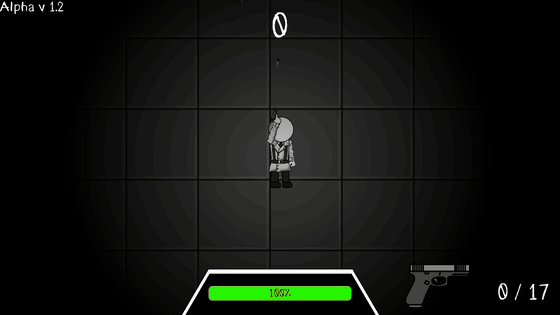

# Try Hit Me

  

A top-down survival shooter made in **Godot 4**. Hold out against waves of robots in a dark arena where the only light is around you, switching between pistol, shotgun and rifle.

## Features

- Endless waves that get harder over time, with several enemy types: tracked robots, mechanical spiders and more
- Three weapons with their own ammo, reload and sound effects
- Lighting that follows the player, so whatever is in the dark is a threat
- Main menu, video and audio options, pause menu, HUD with health bar and a game over screen with high score
- Original theme music

## Controls

| Key | Action |
| --- | --- |
| `W` `A` `S` `D` | Move |
| Mouse | Aim |
| Left click | Shoot |
| `R` | Reload |
| `1` `2` `3` | Switch weapon |
| `Esc` | Pause |

## Running

1. Install [Godot 4.2](https://godotengine.org/download).
2. Open Godot, choose **Import** and select `project.godot` in this folder.
3. Press **F5** to play.

## Team

Made by Caio Pompei, Eduardo Deeke and Gustavo Heitmann.

Caio built the menus, options, HUD, pause and game over screens, added enemies and weapon sound effects, balanced the waves and composed the theme music.
